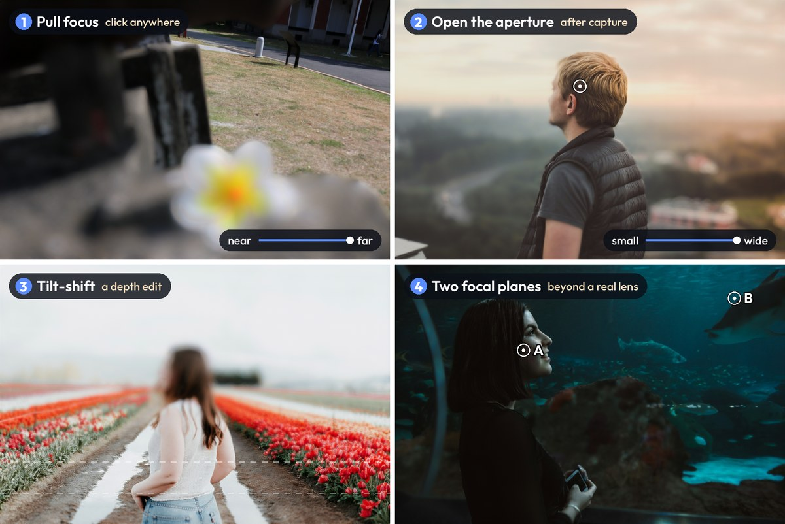
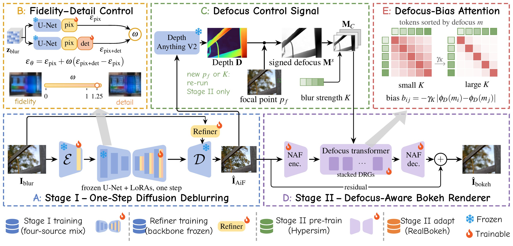

<p align="center"></p>
<h1 align="center">FlashReFocus</h1>
<p align="center"><b>Interactive Image Refocusing in Seconds</b></p>
<p align="center">
  Ching-Heng Cheng<sup>1*</sup> &nbsp;
  <a href="https://ming053l.github.io/">Chia-Ming Lee</a><sup>2,3*</sup> &nbsp;
  <a href="https://mingching.github.io/">Ming-Ching Chang</a><sup>2</sup> &nbsp;
  <a href="https://scholar.google.com/citations?user=gMBvzGoAAAAJ&hl=en">Xin Li</a><sup>2</sup> &nbsp;
  <a href="https://yulunalexliu.github.io/">Yu-Lun Liu</a><sup>3</sup> &nbsp;
  <a href="https://cchsu.info/">Chih-Chung Hsu</a><sup>1,3&dagger;</sup>
</p>
<p align="center">
  <sup>1</sup>National Cheng Kung University &nbsp;
  <sup>2</sup>State University of New York at Albany &nbsp;
  <sup>3</sup>National Yang Ming Chiao Tung University<br>
  <sub>* Equal contribution &nbsp;·&nbsp; &dagger; Corresponding author</sub>
</p>
<p align="center">
  <a href="https://ming053l.github.io/FlashReFocus/assets/FlashReFocus.pdf"></a>
  <a href="https://ming053l.github.io/FlashReFocus/"></a>
  <a href="https://huggingface.co/spaces/ming0531/FlashReFocus"></a>
  <a href="https://huggingface.co/datasets/ming0531/3CReal"></a>
  <a href="https://youtu.be/g032M7moWQ4"></a>
</p>
<p align="center"></p>

Refocus a photograph after it was taken: click where it should be sharp, open or close the aperture, keep two subjects
at different distances sharp at once, or make a tilt-shift miniature. FlashReFocus restores the all-in-focus image
**once** with one-step diffusion; every edit after that runs only a 1.3M-parameter renderer, in about half a second.

| Edit | What it does |
|---|---|
| 📍 **Click to refocus** | any focal point, including regions that were out of focus |
| 🔆 **Aperture after capture** | blur strength from pinhole to wide open; the subject stays sharp |
| 👥 **Two focal planes** | two subjects at different depths sharp at once, beyond a physical lens |
| 🏙️ **Tilt-shift and depth edits** | the renderer reads an explicit depth map, so editing it changes the focus without retraining |

## Quick start

```bash
git clone --recursive https://github.com/ming053l/FlashReFocus && cd FlashReFocus
conda create -n flashrefocus python=3.10 && conda activate flashrefocus
pip install torch==2.7.1 torchvision==0.22.1 --index-url https://download.pytorch.org/whl/cu128
pip install -r requirements.txt && pip install -e .
# weights: see "Setup" below
python scripts/refocus.py photo.jpg out/photo --focus 640 360 --strength 0.5
```

`out/photo_aif.png` is the restored all-in-focus image, `_depth.png` its depth and `_bokeh.png` the refocused result.
The photo is resized to a long side of 1024 (`--long-side`), and coordinates refer to that size (it is printed);
`--two-planes xA yA xB yB` and `--tilt-shift ROW` select the other edits. No GPU at hand? Try the
[Hugging Face demo](https://huggingface.co/spaces/ming0531/FlashReFocus).

## How it works

<p align="center"></p>

- **Stage I, one-step diffusion deblurring** (run once per photograph). Stable Diffusion 2.1 with a pixel LoRA for
  fidelity and a detail LoRA weighted by ω, trained on real and synthetic defocus pairs, and a decoder refiner that
  reinjects structure of the blurred input lost in VAE decoding.
- **Stage II, defocus-aware bokeh rendering** (run per edit). A residual encoder–decoder conditioned on the defocus map
  from Depth Anything V2 depth, the focal point and the blur strength; its defocus-bias attention relates pixels by how
  similarly they are defocused rather than by their distance in the image.

## Results at a glance

| | FlashReFocus | GenRefocus | DiffCamera |
|---|---|---|---|
| Complete refocus at 1536×1536 | **2.5 s** | 371 s (148×) | 136 s (55×) |
| Each further focal edit | **0.47 s** | 217 s | 136 s |
| In-focus regions kept (PSNR to the input, 3CReal) | **44.4 dB** | 29.0 dB | – |

Bokeh rendering: best LPIPS, LPIPS-VGG, DISTS, MS-SSIM and CLIP-I on EBB! Val176 and on our
[3CReal](https://huggingface.co/datasets/ming0531/3CReal) benchmark of unseen cameras (Table 3 of the paper); timings on one NVIDIA RTX PRO 6000 (Table 6).

## Setup

Install as in [Quick start](#quick-start).

### Weights

Weights go into `weights/` (or set `FLASHREFOCUS_WEIGHTS`). The public ones download with `huggingface-cli`
(`pip install huggingface_hub`):

```bash
huggingface-cli download sd2-community/stable-diffusion-2-1-base --local-dir weights/stable-diffusion-2-1-base
huggingface-cli download stable-diffusion-v1-5/stable-diffusion-v1-5 --include "vae/*" --local-dir weights/stable-diffusion-v1-5
huggingface-cli download depth-anything/Depth-Anything-V2-Large depth_anything_v2_vitl.pth --local-dir weights
# Stage I training only: RAM++ for the prompts, and the pretrained one-step LoRAs used as initialisation
huggingface-cli download xinyu1205/recognize-anything-plus-model ram_plus_swin_large_14m.pth --local-dir weights
```

The initial LoRAs for Stage I training (`pisa_sr.pkl`) go to `third_party/PiSA-SR/preset/models/PiSA-SR/`, as described in
that repository. The FlashReFocus weights (`stage1.pkl`, `refiner.pt`, `renderer.pt`) will be released with the paper.

```
weights/
  stable-diffusion-2-1-base/      Stage I backbone
  stable-diffusion-v1-5/vae/      decoder refiner backbone
  depth_anything_v2_vitl.pth      depth for the renderer
  stage1.pkl  refiner.pt  renderer.pt
  ram_plus_swin_large_14m.pth     Stage I training only
```

### Data

Refocusing your own photos needs no dataset. For training and evaluation, download the datasets into `data/` (or set
`FLASHREFOCUS_DATA`) with the folder names below, then build the evaluation sets:

| Folder in `data/` | Dataset | Used for | Source |
|---|---|---|---|
| `dd_dp_dataset_png/` (`train_c`, `val_c`, `test_c`, each with `source/`, `target/`) | DPDD, Canon PNG version | Stage I training, deblurring evaluation | [github.com/Abdullah-Abuolaim/defocus-deblurring-dual-pixel](https://github.com/Abdullah-Abuolaim/defocus-deblurring-dual-pixel) |
| `RealDOF/` (`source/`, `target/`) | RealDOF test set | deblurring evaluation | [github.com/codeslake/IFAN](https://github.com/codeslake/IFAN) (Datasets) |
| `LFDOF/` (`train_data/`, `test_data/`) | LFDOF | Stage I training, LVCorr benchmark | [sweb.cityu.edu.hk/miullam/AIFNET](https://sweb.cityu.edu.hk/miullam/AIFNET/) |
| `div2k/DIV2K_train_HR/` | DIV2K train HR | Stage I training (synthetic blur) | [data.vision.ee.ethz.ch/cvl/DIV2K](https://data.vision.ee.ethz.ch/cvl/DIV2K/) |
| `RealBokeh/` (`train/`, `validation/`, `test/`) | RealBokeh_3MP | Stage I and renderer training, evaluation | `huggingface-cli download timseizinger/RealBokeh_3MP --repo-type dataset --local-dir data/RealBokeh` |
| `EBB/` (`train/`, `validation/`) | EBB! | bokeh-rendering evaluation | [aiff22.github.io/pynet-bokeh.html](https://aiff22.github.io/pynet-bokeh.html#dataset) |
| `3CReal/validation/` (`original/`, `bokeh/`, `focus_point.json`) | [3CReal](https://huggingface.co/datasets/ming0531/3CReal) (ours, 89 pairs, CC BY-NC 4.0) | bokeh-rendering evaluation | `huggingface-cli download ming0531/3CReal --repo-type dataset --local-dir data/3CReal/validation` |
| `MODEST/` | MODEST | aperture-series evaluation (optional) | `huggingface-cli download independent-vision-lab/MODEST --repo-type dataset --local-dir data/MODEST` |
| `Hypersim_processed/` | Hypersim scenes with rendered bokeh targets | renderer pre-training | scenes from [github.com/apple/ml-hypersim](https://github.com/apple/ml-hypersim); target rendering script to be released |

Stage I trains on 4,179 RealBokeh pairs of the top-1000 scenes (`training/configs/realbokeh_deblurring_top1000.csv`);
this manifest and the test pairs in `annotations/deblurring_pairs/` store paths relative to `data/`. Our focal-point annotations for
EBB!, RealBokeh, 3CReal and LFDOF are in `annotations/`; `scripts/prepare_data.py` copies them next to the images and
builds the evaluation folders:

```bash
python scripts/prepare_data.py check   # which datasets are in place
python scripts/prepare_data.py all     # EBB_Val176/, RealBokeh_val_f2.0/, work/lfdof_refocus/, RealBokeh and 3CReal focal points
python scripts/cache_depth.py          # cache Depth Anything V2 depth of RealBokeh for renderer training
```

Evaluation outputs go into `work/` (`FLASHREFOCUS_WORK`); `flashrefocus/paths.py` lists every location.

## Python API

An image is deblurred and its depth estimated once (a `Scene`); every edit then runs only the renderer:

```python
from flashrefocus import Refocuser
from flashrefocus.image_io import read_image, save_image
from flashrefocus.rendering import depth_edits

refocuser = Refocuser.from_pretrained()                     # Stage I with the refiner at ω = 1.25, depth, renderer
scene = refocuser.prepare(read_image("photo.png", "cuda"))   # once per image; sides multiples of 16
focal_depth = scene.focal_depth_at(x, y)                     # D_f of a focal point
save_image(refocuser.render(scene, 0.5, focal_depth), "refocused.png")   # every edit: strength K in [0, 1]

two_planes = depth_edits.two_focal_planes(scene.depth, focal_depth, scene.focal_depth_at(x2, y2))
save_image(refocuser.render(scene, 0.8, focal_depth, depth=two_planes), "two_planes.png")
```

`render` takes the focal depth rather than a pixel, so a video can be processed as one `Scene` per frame with D_f
and K chosen per frame (for example smoothed over time). The stages are also usable alone:
`flashrefocus.deblurring.Deblurrer.from_pretrained()(x)` restores an image in [-1, 1], and
`Refocuser.from_pretrained(deblurring=False)` loads only the depth estimator and the renderer.
`Deblurrer.from_pretrained(separate_unets=True)` keeps the pixel and pixel + detail U-Nets as two modules instead of
swapping weights in place (same output, twice the U-Net memory), as the Hugging Face demo does on ZeroGPU.

Outputs are bit-reproducible with `torch.backends.cudnn.benchmark = False`; cuDNN autotuning is faster for a fixed input
size but may pick different convolution algorithms between runs, changing outputs by a few 1/255.
`Refocuser.from_pretrained(merge_vae_lora=True)` merges the VAE-encoder LoRA for a ~20% faster encoder (outputs ~60 dB
from the exact ones).

## Tests

```bash
pytest tests/test_units.py      # CPU only, no weights: image I/O, depth edits, condition maps, refiner tiling, ...
pytest tests                    # also the end-to-end regression (GPU and the released weights)
```

The regression test restores two small photographs in `tests/data/` and compares the restored image, depth, refocused
image, two focal planes and tilt-shift with `tests/reference/`: bit-identical on the machine that made the references,
PSNR >= 45 dB elsewhere (floating-point differences between GPUs and library versions). Regenerate the references with
`python tests/regression_cases.py` only when an output changes on purpose.

## Training

Run from the repository root:

| Stage (paper section) | Script | Data |
|---|---|---|
| Stage I: deblurring (Sec. 3.1) | `training/train_deblurring.sh` (pixel phase, then detail phase) | DPDD, RealBokeh, LFDOF, DIV2K (`training/configs/deblurring_data.yaml`) |
| Stage I: decoder refiner (Sec. 3.1) | `training/train_decoder_refiner.sh` | same mixture, Stage I latents at ω = 1.25 |
| Stage II: bokeh rendering (Sec. 3.2) | `training/train_renderer.sh` (Hypersim pre-training, RealBokeh adaptation) | Hypersim with BokehMe targets, RealBokeh |

## Evaluation

Run from `eval/` (`cd eval`):

| Result | Scripts |
|---|---|
| Defocus deblurring (DPDD, RealDOF; Table 1) | `scripts/deblur.py --pairs annotations/deblurring_pairs/<set>_test.json`, `score_folders.py` |
| Bokeh rendering (EBB! Val176, 3CReal, RealBokeh val.; Tables 3, G.1) | `bokeh_strength_search.py`, `bokeh_table_metrics.py`, `score_folders.py` |
| Strength control (LVCorr) | `lvcorr.py` |
| Consistency across focal edits (Table H.2) | `focal_edits_render_ours.py`, `focal_edits_render_genrefocus.py`, `focal_edits_match_ours.py`, `focal_edits_match_genrefocus.py`, `focal_edits_metrics.py i` / `ii`, `focal_edits_figures.py` |
| Two focal planes (Appendix H) | `two_focal_planes.py` |
| MODEST aperture series (Appendix G) | `build_modest_series.py`, `modest_strength_analysis.py` |
| Effect of the defocus bias on attention (Appendix C.1) | `attention_bias.py` |
| Renderer residual, defocus embedding and strength scale (Appendix C.1) | `renderer_internals.py` |
| Where the detail branch acts (Appendix F) | `detail_branch.py` |
| Depth source: DA-V2 S/B/L and Depth Pro (Appendix G) | `depth_source.py` |
| Held-out model selection of Stage I (Sec. 4.1) | `scripts/deblur_model_selection.py`, `score_folders.py` |
| Inference cost (Tables 2, 6) | `scripts/benchmark_cost.py deblurring` / `refocusing` |

Outputs of compared methods are produced with their own code (under `baselines/`, `FLASHREFOCUS_BASELINES`) and
scored with the same scripts.

## Repository layout

```
flashrefocus/        the package (pip install -e .)
  deblurring/          Stage I: one-step diffusion (pixel and detail LoRAs, detail weight ω), decoder refiner
  rendering/           Stage II: renderer with defocus-bias attention, depth estimation, depth edits
  pipeline.py          Refocuser: deblur and estimate depth once per image (a Scene), render every focal edit
  image_io.py, layers.py, paths.py
scripts/             command-line tools: refocus a photo, Stage I on a test set, cost benchmark, data preparation
training/            Stage I, decoder-refiner and renderer training, with their data pipelines and configurations
eval/                the paper's evaluations (tables, LVCorr, focal-edit consistency, analyses of Appendices C-H)
tests/               unit tests (CPU) and end-to-end regression tests against pinned outputs (GPU and weights)
annotations/         our focal-point annotations, evaluation subsets and deblurring test lists
third_party/         PiSA-SR (Stage I base code), Depth Anything V2, RAM++ (git submodules)
```

## Citation

If you find FlashReFocus useful, please cite:

```bibtex
@misc{cheng2026flashrefocus,
  title  = {FlashReFocus: Interactive Image Refocusing in Seconds},
  author = {Cheng, Ching-Heng and Lee, Chia-Ming and Chang, Ming-Ching and
            Li, Xin and Liu, Yu-Lun and Hsu, Chih-Chung},
  year   = {2026},
  url    = {https://ming053l.github.io/FlashReFocus/}
}
```

## Acknowledgements

The code builds on [PiSA-SR](https://github.com/csslc/PiSA-SR), [Bokehlicious](https://github.com/TimSeizinger/Bokehlicious),
[Depth Anything V2](https://github.com/DepthAnything/Depth-Anything-V2) and
[RAM++](https://github.com/xinyu1205/recognize-anything); their licenses apply to the corresponding parts.
