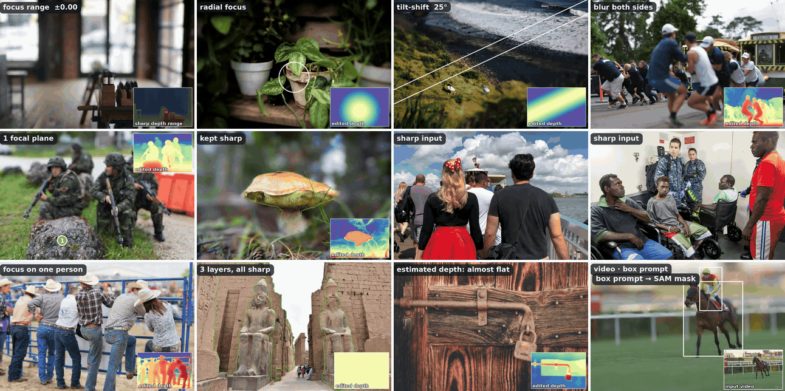

<p align="center"></p>
<h1 align="center">FlashReFocus</h1>
<p align="center"><b>Interactive Image Refocusing in Seconds</b></p>
<p align="center">
  <a href="https://chingheng0808.github.io/">Ching-Heng Cheng</a><sup>1*</sup> &nbsp;
  <a href="https://ming053l.github.io/">Chia-Ming Lee</a><sup>2,3*</sup> &nbsp;
  <a href="https://mingching.github.io/">Ming-Ching Chang</a><sup>2</sup> &nbsp;
  <a href="https://scholar.google.com/citations?user=gMBvzGoAAAAJ&hl=en">Xin Li</a><sup>2</sup> &nbsp;
  <a href="https://cchsu.info/">Chih-Chung Hsu</a><sup>1,3&dagger;</sup>
</p>
<p align="center">
  <sup>1</sup>National Cheng Kung University &nbsp;
  <sup>2</sup>State University of New York at Albany &nbsp;
  <sup>3</sup>National Yang Ming Chiao Tung University<br>
  <sub>* Equal contribution &nbsp;·&nbsp; &dagger; Corresponding author</sub>
</p>
<p align="center">
  <a href="https://arxiv.org/pdf/2610.23297"></a>
  <a href="https://arxiv.org/abs/2610.23297"></a>
  <a href="https://ming053l.github.io/FlashReFocus/"></a>
  <a href="https://huggingface.co/spaces/ming0531/FlashReFocus"></a>
  <a href="https://huggingface.co/spaces/ming0531/FlashReFocus-CPU"></a>
  <a href="https://huggingface.co/spaces/ming0531/FlashReFocus-Video"></a>
  <a href="https://huggingface.co/ming0531/FlashReFocus-weights"></a>
  <a href="https://huggingface.co/datasets/ming0531/3CReal"></a>
  <a href="https://youtu.be/g032M7moWQ4"></a>
</p>
<p align="center"></p>
<p align="center"><sub>Video spotlight on a 4K concert clip: a SAM 3 mask (green, left), prompted with the word "person" and picked automatically, keeps the lead singer sharp in every frame while the dancers around her blur (right); insets show the estimated and the edited depth. Try it on your own clip in the <a href="https://huggingface.co/spaces/ming0531/FlashReFocus-Video">video spotlight demo</a>.</sub></p>

<p align="center"></p>

Refocus a photograph after it was taken: click where it should be sharp, open or close the aperture, keep two subjects
at different distances sharp at once, or make a tilt-shift miniature. FlashReFocus restores the all-in-focus image
**once** with one-step diffusion; every edit after that runs only a 1.3M-parameter renderer, in about half a second.

| Edit | What it does |
|---|---|
| 📍 **Click to refocus** | any focal point, including regions that were out of focus |
| 🔆 **Aperture after capture** | blur strength from pinhole to wide open; the subject stays sharp |
| 👥 **Two focal planes** | two subjects at different depths sharp at once, beyond a physical lens |
| 🏙️ **Tilt-shift and depth edits** | the renderer reads an explicit depth map, so editing it changes the focus without retraining |
| 🎭 **Mask edits** | keep a subject sharp, push a photobomber into the bokeh, blur faces optically, give each layer its own blur |
| 🎬 **Video** | focus pulls, and a spotlight that keeps one subject sharp (SAM 3 picks and follows the subject from a text prompt), with depth and focus smoothed over time |
| 🧩 **ComfyUI** | all of the above as ComfyUI nodes, with example workflows ([comfyui/](comfyui)) |

### News

- **2026-11-21** Video spotlight with SAM 3, and optional speed-ups (a fused attention kernel for the renderer, compiled Stage I). See [flashrefocus/README.md](flashrefocus/README.md).
- **2026-11-19** ComfyUI nodes ([comfyui/](comfyui)) and more depth edits: focus range, radial focus, tilt-shift at any angle, several focal planes, mask edits.

### TODO

- ✅ Inference code, model weights and training code
- ✅ ComfyUI nodes, including the video spotlight
- ✅ Optional speed-ups: fused renderer attention and compiled Stage I

## Quick start

```bash
git clone --recursive https://github.com/ming053l/FlashReFocus && cd FlashReFocus
conda create -n flashrefocus python=3.10 && conda activate flashrefocus
pip install torch==2.7.1 torchvision==0.22.1 --index-url https://download.pytorch.org/whl/cu128
pip install -r requirements.txt && pip install -e .
# weights: see "Setup" below
python scripts/refocus.py photo.jpg out/photo --focus 640 360 --strength 0.5
```

`out/photo_aif.png` is the restored all-in-focus image, `_depth.png` its depth and `_bokeh.png` the refocused result.
The photo is resized to a long side of 1024 (`--long-side`), and coordinates refer to that size (it is printed);
`--two-planes xA yA xB yB` and `--tilt-shift ROW` select the other edits. No GPU at hand? Try the
[Hugging Face demo](https://huggingface.co/spaces/ming0531/FlashReFocus), or the
[CPU demo](https://huggingface.co/spaces/ming0531/FlashReFocus-CPU) for photographs that are already sharp.

## ComfyUI

Every control is also available as ComfyUI nodes: refocus and aperture, focus range, several focal planes, one-sided blur, radial focus, tilt-shift at any angle, mask edits (keep a subject sharp, remove a photobomber, privacy blur), and a video spotlight that keeps one subject sharp, with the subject found and followed by SAM 3 from a text prompt or given as a mask video. Link [`comfyui/`](comfyui) into `ComfyUI/custom_nodes/` and load an example from [`comfyui/workflows/`](comfyui/workflows); weights download on first use. See [comfyui/README.md](comfyui/README.md).

## Applications

The renderer was trained with one focal plane and one strength per image, yet it renders any depth map it is given, so every effect at the top of this page is zero-shot: edit the depth, then render. All examples are real photographs and videos (the small inset shows the edited depth or the input frame); animated versions are on the [project page](https://ming053l.github.io/FlashReFocus/). Masks can come from any segmenter, for example [Segment Anything](https://github.com/facebookresearch/segment-anything) or [CLIPSeg](https://github.com/timojl/clipseg). The function and ComfyUI node for every effect, with code, are listed in [flashrefocus/README.md](flashrefocus/README.md#depth-edits).

## How it works

<p align="center"></p>

- **Stage I, one-step diffusion deblurring** (run once per photograph). Stable Diffusion 2.1 with a pixel LoRA for
  fidelity and a detail LoRA weighted by ω, trained on real and synthetic defocus pairs, and a decoder refiner that
  reinjects structure of the blurred input lost in VAE decoding.
- **Stage II, defocus-aware bokeh rendering** (run per edit). A residual encoder–decoder conditioned on the defocus map
  from Depth Anything V2 depth, the focal point and the blur strength; its defocus-bias attention relates pixels by how
  similarly they are defocused rather than by their distance in the image.

## Results at a glance

| | FlashReFocus | GenRefocus | DiffCamera |
|---|---|---|---|
| Complete refocus at 1536×1536 | **2.45 s** | 371 s (151×) | 136 s (56×) |
| Each further focal edit | **0.46 s** | 217 s (472×) | 136 s (296×) |
| In-focus regions kept (PSNR to the input, 3CReal) | **44.4 dB** | 29.0 dB | – |

Bokeh rendering: best LPIPS, LPIPS-VGG, DISTS, MS-SSIM and CLIP-I on EBB! Val176 and on our
[3CReal](https://huggingface.co/datasets/ming0531/3CReal) benchmark of unseen cameras (Table 3 of the paper); timings on one NVIDIA RTX PRO 6000 (Table 6).

## Setup

Install as in [Quick start](#quick-start). Weights go into `weights/` (or set `FLASHREFOCUS_WEIGHTS`). Download the backbone weights with `huggingface-cli`
(`pip install huggingface_hub`):

```bash
huggingface-cli download sd2-community/stable-diffusion-2-1-base --local-dir weights/stable-diffusion-2-1-base
huggingface-cli download stable-diffusion-v1-5/stable-diffusion-v1-5 --include "vae/*" --local-dir weights/stable-diffusion-v1-5
huggingface-cli download depth-anything/Depth-Anything-V2-Large depth_anything_v2_vitl.pth --local-dir weights
```

Download our trained checkpoints from [ming0531/FlashReFocus-weights](https://huggingface.co/ming0531/FlashReFocus-weights) (no login required):

```bash
huggingface-cli download ming0531/FlashReFocus-weights stage1.pkl refiner.pt renderer.pt --local-dir weights
```

Training needs further weights and the datasets; see
[training/README.md](training/README.md).

```
weights/
  stable-diffusion-2-1-base/      Stage I backbone
  stable-diffusion-v1-5/vae/      decoder refiner backbone
  depth_anything_v2_vitl.pth      depth for the renderer
  stage1.pkl  refiner.pt  renderer.pt
```

## Python API

An image is deblurred and its depth estimated once (a `Scene`); every edit then runs only the renderer:

```python
from flashrefocus import Refocuser
from flashrefocus.image_io import read_image, save_image
from flashrefocus.rendering import depth_edits

refocuser = Refocuser.from_pretrained()                     # Stage I with the refiner at ω = 1.25, depth, renderer
scene = refocuser.prepare(read_image("photo.png", "cuda"))   # once per image; sides multiples of 16
focal_depth = scene.focal_depth_at(x, y)                     # D_f of a focal point
save_image(refocuser.render(scene, 0.5, focal_depth), "refocused.png")   # every edit: strength K in [0, 1]

two_planes = depth_edits.two_focal_planes(scene.depth, focal_depth, scene.focal_depth_at(x2, y2))
save_image(refocuser.render(scene, 0.8, focal_depth, depth=two_planes), "two_planes.png")
```

`Refocuser.from_pretrained(deblurring=False)` skips Stage I for images that are already sharp. We additionally
provide an optimized inference path, off by default so that the reported numbers are reproduced exactly:
`fused=True` (a fused attention kernel for the renderer) and `compile="static"` (compiled Stage I).

All loading options, the video spotlight, background image writing, the video writer and the speed-ups are described
in [flashrefocus/README.md](flashrefocus/README.md).

## Tests

```bash
pytest tests/test_units.py      # CPU only, no weights: image I/O, depth edits, condition maps, refiner tiling, ...
pytest tests                    # also the end-to-end regression (GPU and the released weights)
```

Details of the regression test are in [flashrefocus/README.md](flashrefocus/README.md#tests).

## Training and evaluation

Datasets, training and the scripts behind every table of the paper are described in
[training/README.md](training/README.md) and [eval/README.md](eval/README.md).

## Repository layout

```
flashrefocus/        the package (pip install -e .)
  deblurring/          Stage I: one-step diffusion (pixel and detail LoRAs, detail weight ω), decoder refiner
  rendering/           Stage II: renderer with defocus-bias attention, depth estimation, depth edits
  pipeline.py          Refocuser: deblur and estimate depth once per image (a Scene), render every focal edit
  segment.py           SAM 3 subject tracking for the video spotlight
  overlays.py          keeping burnt-in titles sharp in video
  video.py             streaming video writer
  image_io.py, layers.py, paths.py
  README.md            all options of the Python API
comfyui/             ComfyUI custom nodes and example workflows
scripts/             command-line tools: refocus a photo, Stage I on a test set, cost benchmark, data preparation
training/            Stage I, decoder-refiner and renderer training, with their data pipelines and configurations (README: data)
eval/                the paper's evaluations (tables, LVCorr, focal-edit consistency, analyses of Appendices C-H)
tests/               unit tests (CPU) and end-to-end regression tests against pinned outputs (GPU and weights)
annotations/         our focal-point annotations, evaluation subsets and deblurring test lists
third_party/         PiSA-SR (Stage I base code), Depth Anything V2, RAM++ (git submodules)
```

## Citation

If you find FlashReFocus useful, please cite:

```bibtex
@misc{cheng2026flashrefocus,
  title         = {FlashReFocus: Interactive Image Refocusing in Seconds},
  author        = {Cheng, Ching-Heng and Lee, Chia-Ming and Chang, Ming-Ching and
                   Li, Xin and Hsu, Chih-Chung},
  year          = {2026},
  eprint        = {2610.23297},
  archivePrefix = {arXiv},
  primaryClass  = {cs.CV},
  url           = {https://arxiv.org/abs/2610.23297}
}
```

## Acknowledgements

The code builds on [PiSA-SR](https://github.com/csslc/PiSA-SR), [Bokehlicious](https://github.com/TimSeizinger/Bokehlicious),
[Depth Anything V2](https://github.com/DepthAnything/Depth-Anything-V2) and
[RAM++](https://github.com/xinyu1205/recognize-anything); their licenses apply to the corresponding parts.
