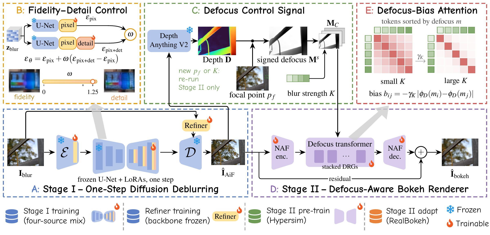

<p align="center"></p>
<h1 align="center">FlashReFocus</h1>
<p align="center"><b>Interactive Image Refocusing in Seconds</b></p>
<p align="center">
  <a href="https://chingheng0808.github.io/">Ching-Heng Cheng</a><sup>1*</sup> &nbsp;
  <a href="https://ming053l.github.io/">Chia-Ming Lee</a><sup>2,3*</sup> &nbsp;
  <a href="https://mingching.github.io/">Ming-Ching Chang</a><sup>2</sup> &nbsp;
  <a href="https://scholar.google.com/citations?user=gMBvzGoAAAAJ&hl=en">Xin Li</a><sup>2</sup> &nbsp;
  <a href="https://cchsu.info/">Chih-Chung Hsu</a><sup>1,3&dagger;</sup>
</p>
<p align="center">
  <sup>1</sup>National Cheng Kung University &nbsp;
  <sup>2</sup>State University of New York at Albany &nbsp;
  <sup>3</sup>National Yang Ming Chiao Tung University<br>
  <sub>* Equal contribution &nbsp;·&nbsp; &dagger; Corresponding author</sub>
</p>
<p align="center">
  <a href="https://arxiv.org/pdf/2610.23297"></a>
  <a href="https://arxiv.org/abs/2610.23297"></a>
  <a href="https://ming053l.github.io/FlashReFocus/"></a>
  <a href="https://huggingface.co/spaces/ming0531/FlashReFocus"></a>
  <a href="https://huggingface.co/ming0531/FlashReFocus-weights"></a>
  <a href="https://huggingface.co/datasets/ming0531/3CReal"></a>
  <a href="https://youtu.be/g032M7moWQ4"></a>
</p>
<p align="center"></p>
<p align="center"><sub>Video spotlight on a 4K concert clip: a SAM 3 mask (green, left), prompted with the word "person" and picked automatically, keeps the lead singer sharp in every frame while the dancers around her blur (right); insets show the estimated and the edited depth.</sub></p>

<p align="center"></p>

Refocus a photograph after it was taken: click where it should be sharp, open or close the aperture, keep two subjects
at different distances sharp at once, or make a tilt-shift miniature. FlashReFocus restores the all-in-focus image
**once** with one-step diffusion; every edit after that runs only a 1.3M-parameter renderer, in about half a second.

| Edit | What it does |
|---|---|
| 📍 **Click to refocus** | any focal point, including regions that were out of focus |
| 🔆 **Aperture after capture** | blur strength from pinhole to wide open; the subject stays sharp |
| 👥 **Two focal planes** | two subjects at different depths sharp at once, beyond a physical lens |
| 🏙️ **Tilt-shift and depth edits** | the renderer reads an explicit depth map, so editing it changes the focus without retraining |
| 🎭 **Mask edits** | keep a subject sharp, push a photobomber into the bokeh, blur faces optically, give each layer its own blur |
| 🎬 **Video** | focus pulls, and a spotlight that keeps one subject sharp (SAM 3 picks and follows the subject from a text prompt), with depth and focus smoothed over time |
| 🧩 **ComfyUI** | all of the above as ComfyUI nodes, with example workflows ([comfyui/](comfyui)) |

### News

- **2026-11-21** 🆕 **Faster renderer and restoration, video spotlight and SAM 3.** `Refocuser.from_pretrained(fused=True)` runs the renderer's defocus-bias attention as one Triton kernel that never stores the bias or attention matrices: the same output up to floating-point rounding, peak renderer memory down from 16.1 to 3.0 GiB at 3840×1728 (3.5 to 1.1 GiB at 1536×1536), and faster (the ComfyUI loader turns it on); `compile="static"` or `"dynamic"` makes Stage I restoration about 35-40% faster with `torch.compile`. New `depth_edits.spotlight` keeps one subject sharp and pushes everyone else out of focus, `flashrefocus.segment.track_subject` finds and follows the subject with SAM 3 from a text prompt, and `flashrefocus.overlays` keeps burnt-in titles sharp. ComfyUI gains four nodes and three video workflows.

- **2026-11-19** 🆕 **ComfyUI nodes and more depth edits.** FlashReFocus now runs in ComfyUI ([comfyui/](comfyui)), with four example workflows, and `flashrefocus.rendering.depth_edits` gains focus range, radial focus, tilt-shift at any angle, one-sided blur, any number of focal planes and mask edits (keep sharp, push to the background, move away for privacy blur, isolate a subject). See [Applications](#applications).

### TODO

- ✅ Release inference code and model weights
- ✅ Release training code
- ✅ ComfyUI nodes for refocusing, depth edits, mask edits and video spotlight ([comfyui/](comfyui))
- ✅ Fused Triton kernel for the renderer's attention (`fused=True`) and compiled Stage I (`compile=`)
- ✅ Background PNG writing and a streaming video writer (`flashrefocus.video`)

## Quick start

```bash
git clone --recursive https://github.com/ming053l/FlashReFocus && cd FlashReFocus
conda create -n flashrefocus python=3.10 && conda activate flashrefocus
pip install torch==2.7.1 torchvision==0.22.1 --index-url https://download.pytorch.org/whl/cu128
pip install -r requirements.txt && pip install -e .
# weights: see "Setup" below
python scripts/refocus.py photo.jpg out/photo --focus 640 360 --strength 0.5
```

`out/photo_aif.png` is the restored all-in-focus image, `_depth.png` its depth and `_bokeh.png` the refocused result.
The photo is resized to a long side of 1024 (`--long-side`), and coordinates refer to that size (it is printed);
`--two-planes xA yA xB yB` and `--tilt-shift ROW` select the other edits. No GPU at hand? Try the
[Hugging Face demo](https://huggingface.co/spaces/ming0531/FlashReFocus).

## ComfyUI

Every control is also available as ComfyUI nodes: refocus and aperture, focus range, several focal planes, one-sided blur, radial focus, tilt-shift at any angle, mask edits (keep a subject sharp, remove a photobomber, privacy blur), and a video spotlight that keeps one subject sharp, with the subject found and followed by SAM 3 from a text prompt or given as a mask video. Link [`comfyui/`](comfyui) into `ComfyUI/custom_nodes/` and load an example from [`comfyui/workflows/`](comfyui/workflows); weights download on first use. See [comfyui/README.md](comfyui/README.md).

## Applications

The renderer was trained with one focal plane and one strength per image, yet it renders any depth map it is given, so every effect below is zero-shot: edit the depth, then render. All examples at the top of this page are real photographs and videos (the small inset shows the edited depth or the input frame); animated versions are on the [project page](https://ming053l.github.io/FlashReFocus/).

| Effect | `depth_edits` function | ComfyUI node |
|---|---|---|
| Focus range: a thick focal plane, separate from the aperture | `focus_range` | Focus Range |
| Radial (Lensbaby-style) focus around a point | `radial_focus` | Radial Focus |
| Tilt-shift band at any angle | `tilted_band` (`tilt_shift` for horizontal) | Tilt-Shift |
| Blur only the background, or only the foreground | `one_sided` | One-Sided Blur |
| Two, three or more focal planes | `focal_planes` (`two_focal_planes`) | Add Focal Plane |
| Keep a masked subject sharp while the focus moves | `keep_sharp` | Focus on Mask, Mask Depth Edit |
| Remove a photobomber: push him into the background bokeh (no inpainting) | `set_mask_depth(…, 1.0)` | Mask Depth Edit (`push_far`) |
| Optical privacy blur for faces or plates | `move_away` | Mask Depth Edit (`move_away`) |
| Per-layer blur, or a front layer for a flat picture | `set_mask_depth` | Mask Depth Edit (`set_depth`) |
| Isolate a subject: everything else at least a set distance from focus | `isolate` | Mask Depth Edit (`isolate`) |
| Portrait mode on a sharp photograph (skip Stage I) | `prepare(image, deblur=False)` | Prepare (`already_sharp`) |
| Video focus pull | one `Scene` per frame, smoothed depth and focus | Prepare + Focus Point with an image batch |
| Video spotlight (one subject sharp, everyone else blurred) | `spotlight` + `flashrefocus.segment.track_subject` (SAM 3) | SAM 3 Subject + Spotlight |
| Burnt-in titles kept sharp in video | `flashrefocus.overlays.fill_region` / `paste_back` | Overlay Fill + Overlay Paste Back |

Masks can come from any segmenter, for example [Segment Anything](https://github.com/facebookresearch/segment-anything) or [CLIPSeg](https://github.com/timojl/clipseg); neither is part of FlashReFocus. Python code for every edit is in [flashrefocus/README.md](flashrefocus/README.md#depth-edits).

## How it works

<p align="center"></p>

- **Stage I, one-step diffusion deblurring** (run once per photograph). Stable Diffusion 2.1 with a pixel LoRA for
  fidelity and a detail LoRA weighted by ω, trained on real and synthetic defocus pairs, and a decoder refiner that
  reinjects structure of the blurred input lost in VAE decoding.
- **Stage II, defocus-aware bokeh rendering** (run per edit). A residual encoder–decoder conditioned on the defocus map
  from Depth Anything V2 depth, the focal point and the blur strength; its defocus-bias attention relates pixels by how
  similarly they are defocused rather than by their distance in the image.

## Results at a glance

| | FlashReFocus | GenRefocus | DiffCamera |
|---|---|---|---|
| Complete refocus at 1536×1536 | **2.45 s** | 371 s (151×) | 136 s (56×) |
| Each further focal edit | **0.46 s** | 217 s (472×) | 136 s (296×) |
| In-focus regions kept (PSNR to the input, 3CReal) | **44.4 dB** | 29.0 dB | – |

Bokeh rendering: best LPIPS, LPIPS-VGG, DISTS, MS-SSIM and CLIP-I on EBB! Val176 and on our
[3CReal](https://huggingface.co/datasets/ming0531/3CReal) benchmark of unseen cameras (Table 3 of the paper); timings on one NVIDIA RTX PRO 6000 (Table 6).

## Setup

Install as in [Quick start](#quick-start).

### Weights

Weights go into `weights/` (or set `FLASHREFOCUS_WEIGHTS`). Download the backbone weights with `huggingface-cli`
(`pip install huggingface_hub`):

```bash
huggingface-cli download sd2-community/stable-diffusion-2-1-base --local-dir weights/stable-diffusion-2-1-base
huggingface-cli download stable-diffusion-v1-5/stable-diffusion-v1-5 --include "vae/*" --local-dir weights/stable-diffusion-v1-5
huggingface-cli download depth-anything/Depth-Anything-V2-Large depth_anything_v2_vitl.pth --local-dir weights
# Stage I training only: RAM++ for the prompts, and the pretrained one-step LoRAs used as initialisation
huggingface-cli download xinyu1205/recognize-anything-plus-model ram_plus_swin_large_14m.pth --local-dir weights
```

The initial LoRAs for Stage I training (`pisa_sr.pkl`) go to `third_party/PiSA-SR/preset/models/PiSA-SR/`, as described in
that repository.

Our trained checkpoints are publicly available at [ming0531/FlashReFocus-weights](https://huggingface.co/ming0531/FlashReFocus-weights):

| Checkpoint | Component |
|---|---|
| [`stage1.pkl`](https://huggingface.co/ming0531/FlashReFocus-weights/resolve/main/stage1.pkl) | Stage I: trained pixel and detail LoRAs for one-step deblurring |
| [`refiner.pt`](https://huggingface.co/ming0531/FlashReFocus-weights/resolve/main/refiner.pt) | Stage I: trained decoder refiner |
| [`renderer.pt`](https://huggingface.co/ming0531/FlashReFocus-weights/resolve/main/renderer.pt) | Stage II: bokeh renderer after RealBokeh adaptation |

Download all three checkpoints (no login required):

```bash
huggingface-cli download ming0531/FlashReFocus-weights stage1.pkl refiner.pt renderer.pt --local-dir weights
```

These are trained model checkpoints, not a complete training-resume snapshot for all stages. The backbone weights
listed above are required separately; see [Training](#training) for the training scripts and datasets.

```
weights/
  stable-diffusion-2-1-base/      Stage I backbone
  stable-diffusion-v1-5/vae/      decoder refiner backbone
  depth_anything_v2_vitl.pth      depth for the renderer
  stage1.pkl  refiner.pt  renderer.pt
  ram_plus_swin_large_14m.pth     Stage I training only
```

### Data

Refocusing your own photos needs no dataset. For training and evaluation, download the datasets into `data/` (or set
`FLASHREFOCUS_DATA`) with the folder names below, then build the evaluation sets:

| Folder in `data/` | Dataset | Used for | Source |
|---|---|---|---|
| `dd_dp_dataset_png/` (`train_c`, `val_c`, `test_c`, each with `source/`, `target/`) | DPDD, Canon PNG version | Stage I training, deblurring evaluation | [github.com/Abdullah-Abuolaim/defocus-deblurring-dual-pixel](https://github.com/Abdullah-Abuolaim/defocus-deblurring-dual-pixel) |
| `RealDOF/` (`source/`, `target/`) | RealDOF test set | deblurring evaluation | [github.com/codeslake/IFAN](https://github.com/codeslake/IFAN) (Datasets) |
| `LFDOF/` (`train_data/`, `test_data/`) | LFDOF | Stage I training, LVCorr benchmark | [sweb.cityu.edu.hk/miullam/AIFNET](https://sweb.cityu.edu.hk/miullam/AIFNET/) |
| `div2k/DIV2K_train_HR/` | DIV2K train HR | Stage I training (synthetic blur) | [data.vision.ee.ethz.ch/cvl/DIV2K](https://data.vision.ee.ethz.ch/cvl/DIV2K/) |
| `RealBokeh/` (`train/`, `validation/`, `test/`) | RealBokeh_3MP | Stage I and renderer training, evaluation | `huggingface-cli download timseizinger/RealBokeh_3MP --repo-type dataset --local-dir data/RealBokeh` |
| `EBB/` (`train/`, `validation/`) | EBB! | bokeh-rendering evaluation | [aiff22.github.io/pynet-bokeh.html](https://aiff22.github.io/pynet-bokeh.html#dataset) |
| `3CReal/validation/` (`original/`, `bokeh/`, `focus_point.json`) | [3CReal](https://huggingface.co/datasets/ming0531/3CReal) (ours, 89 pairs, CC BY-NC 4.0) | bokeh-rendering evaluation | `huggingface-cli download ming0531/3CReal --repo-type dataset --local-dir data/3CReal/validation` |
| `MODEST/` | MODEST | aperture-series evaluation (optional) | `huggingface-cli download independent-vision-lab/MODEST --repo-type dataset --local-dir data/MODEST` |
| `Hypersim_processed/` | Hypersim scenes with rendered bokeh targets | renderer pre-training | scenes from [github.com/apple/ml-hypersim](https://github.com/apple/ml-hypersim); target rendering script to be released |

Stage I trains on 4,179 RealBokeh pairs of the top-1000 scenes (`training/configs/realbokeh_deblurring_top1000.csv`);
this manifest and the test pairs in `annotations/deblurring_pairs/` store paths relative to `data/`. Our focal-point annotations for
EBB!, RealBokeh, 3CReal and LFDOF are in `annotations/`; `scripts/prepare_data.py` copies them next to the images and
builds the evaluation folders:

```bash
python scripts/prepare_data.py check   # which datasets are in place
python scripts/prepare_data.py all     # EBB_Val176/, RealBokeh_val_f2.0/, work/lfdof_refocus/, RealBokeh and 3CReal focal points
python scripts/cache_depth.py          # cache Depth Anything V2 depth of RealBokeh for renderer training
```

Evaluation outputs go into `work/` (`FLASHREFOCUS_WORK`); `flashrefocus/paths.py` lists every location.

## Python API

An image is deblurred and its depth estimated once (a `Scene`); every edit then runs only the renderer:

```python
from flashrefocus import Refocuser
from flashrefocus.image_io import read_image, save_image
from flashrefocus.rendering import depth_edits

refocuser = Refocuser.from_pretrained()                     # Stage I with the refiner at ω = 1.25, depth, renderer
scene = refocuser.prepare(read_image("photo.png", "cuda"))   # once per image; sides multiples of 16
focal_depth = scene.focal_depth_at(x, y)                     # D_f of a focal point
save_image(refocuser.render(scene, 0.5, focal_depth), "refocused.png")   # every edit: strength K in [0, 1]

two_planes = depth_edits.two_focal_planes(scene.depth, focal_depth, scene.focal_depth_at(x2, y2))
save_image(refocuser.render(scene, 0.8, focal_depth, depth=two_planes), "two_planes.png")
```

`Refocuser.from_pretrained(deblurring=False)` skips Stage I for images that are already sharp. We additionally
provide an optimized inference path, off by default so that the reported numbers are reproduced exactly:
`fused=True` (a fused attention kernel for the renderer) and `compile="static"` (compiled Stage I).

**Video spotlight.** Keep one subject sharp in a sharp video and blur everyone around them:

```python
from flashrefocus.segment import track_subject        # SAM 3: transformers >= 4.57, access to facebook/sam3

refocuser = Refocuser.from_pretrained(deblurring=False, fused=True)
subject, others = track_subject(frames, prompt="person")   # frames: (n, h, w, 3) uint8
for frame, m, o in zip(frames_as_tensors, subject, others):
    scene = refocuser.prepare(frame, deblur=False)
    d_f = float(scene.depth[0][m].median())
    depth, _ = depth_edits.spotlight(scene.depth, m[None], d_f, others=o[None])
    out = refocuser.render(scene, 1.5, d_f, depth=depth)
```

All loading options, the video and overlay tools, background image writing, the video writer and the speed-ups are
described in [flashrefocus/README.md](flashrefocus/README.md).

## Tests

```bash
pytest tests/test_units.py      # CPU only, no weights: image I/O, depth edits, condition maps, refiner tiling, ...
pytest tests                    # also the end-to-end regression (GPU and the released weights)
```

Details of the regression test are in [flashrefocus/README.md](flashrefocus/README.md#tests).

## Training

Run from the repository root:

| Stage (paper section) | Script | Data |
|---|---|---|
| Stage I: deblurring (Sec. 3.1) | `training/train_deblurring.sh` (pixel phase, then detail phase) | DPDD, RealBokeh, LFDOF, DIV2K (`training/configs/deblurring_data.yaml`) |
| Stage I: decoder refiner (Sec. 3.1) | `training/train_decoder_refiner.sh` | same mixture, Stage I latents at ω = 1.25 |
| Stage II: bokeh rendering (Sec. 3.2) | `training/train_renderer.sh` (Hypersim pre-training, RealBokeh adaptation) | Hypersim with BokehMe targets, RealBokeh |

## Evaluation

Run from `eval/` (`cd eval`):

| Result | Scripts |
|---|---|
| Defocus deblurring (DPDD, RealDOF; Table 1) | `scripts/deblur.py --pairs annotations/deblurring_pairs/<set>_test.json`, `score_folders.py` |
| Bokeh rendering (EBB! Val176, 3CReal, RealBokeh val.; Tables 3, G.1) | `bokeh_strength_search.py`, `bokeh_table_metrics.py`, `score_folders.py` |
| Strength control (LVCorr) | `lvcorr.py` |
| Consistency across focal edits (Table H.2) | `focal_edits_render_ours.py`, `focal_edits_render_genrefocus.py`, `focal_edits_match_ours.py`, `focal_edits_match_genrefocus.py`, `focal_edits_metrics.py i` / `ii`, `focal_edits_figures.py` |
| Two focal planes (Appendix H) | `two_focal_planes.py` |
| MODEST aperture series (Appendix G) | `build_modest_series.py`, `modest_strength_analysis.py` |
| Effect of the defocus bias on attention (Appendix C.1) | `attention_bias.py` |
| Renderer residual, defocus embedding and strength scale (Appendix C.1) | `renderer_internals.py` |
| Where the detail branch acts (Appendix F) | `detail_branch.py` |
| Depth source: DA-V2 S/B/L and Depth Pro (Appendix G) | `depth_source.py` |
| Held-out model selection of Stage I (Sec. 4.1) | `scripts/deblur_model_selection.py`, `score_folders.py` |
| Inference cost (Tables 2, 6) | `scripts/benchmark_cost.py deblurring` / `refocusing` |

Outputs of compared methods are produced with their own code (under `baselines/`, `FLASHREFOCUS_BASELINES`) and
scored with the same scripts.

## Repository layout

```
flashrefocus/        the package (pip install -e .)
  deblurring/          Stage I: one-step diffusion (pixel and detail LoRAs, detail weight ω), decoder refiner
  rendering/           Stage II: renderer with defocus-bias attention, depth estimation, depth edits
  pipeline.py          Refocuser: deblur and estimate depth once per image (a Scene), render every focal edit
  segment.py           SAM 3 subject tracking for the video spotlight
  overlays.py          keeping burnt-in titles sharp in video
  video.py             streaming video writer
  image_io.py, layers.py, paths.py
  README.md            all options of the Python API
comfyui/             ComfyUI custom nodes and example workflows
scripts/             command-line tools: refocus a photo, Stage I on a test set, cost benchmark, data preparation
training/            Stage I, decoder-refiner and renderer training, with their data pipelines and configurations
eval/                the paper's evaluations (tables, LVCorr, focal-edit consistency, analyses of Appendices C-H)
tests/               unit tests (CPU) and end-to-end regression tests against pinned outputs (GPU and weights)
annotations/         our focal-point annotations, evaluation subsets and deblurring test lists
third_party/         PiSA-SR (Stage I base code), Depth Anything V2, RAM++ (git submodules)
```

## Citation

If you find FlashReFocus useful, please cite:

```bibtex
@misc{cheng2026flashrefocus,
  title         = {FlashReFocus: Interactive Image Refocusing in Seconds},
  author        = {Cheng, Ching-Heng and Lee, Chia-Ming and Chang, Ming-Ching and
                   Li, Xin and Hsu, Chih-Chung},
  year          = {2026},
  eprint        = {2610.23297},
  archivePrefix = {arXiv},
  primaryClass  = {cs.CV},
  url           = {https://arxiv.org/abs/2610.23297}
}
```

## Acknowledgements

The code builds on [PiSA-SR](https://github.com/csslc/PiSA-SR), [Bokehlicious](https://github.com/TimSeizinger/Bokehlicious),
[Depth Anything V2](https://github.com/DepthAnything/Depth-Anything-V2) and
[RAM++](https://github.com/xinyu1205/recognize-anything); their licenses apply to the corresponding parts.
